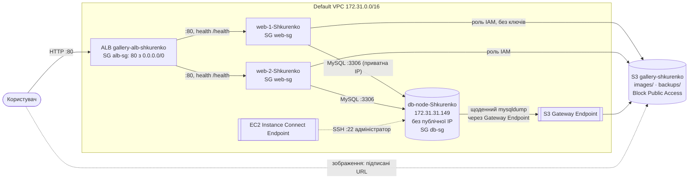

# Фотогалерея в AWS — Shkurenko

Триланкова система: **Application Load Balancer → 2 × web (Flask + gunicorn) → db (MySQL 8.0)**,
зображення та бекапи БД у **S3**. Регіон `us-east-1`.

**Адреса сайту (DNS балансувальника):**
http://gallery-alb-shkurenko-375269311.us-east-1.elb.amazonaws.com/

## Архітектура



```
Користувач ──HTTP:80──► ALB (alb-sg) ──:80──► web-1 ┐               ┌─► S3 gallery-shkurenko
                                     └──:80──► web-2 ┴─:3306─► db ───┘   (images/, backups/)
```

## Що де налаштовано

| Вимога | Як виконано | Де |
|---|---|---|
| **И1** 3 × EC2 Ubuntu 24.04 | `web-1-Shkurenko`, `web-2-Shkurenko`, `db-node-Shkurenko` (t3.micro, AMI ubuntu-noble-24.04) | EC2 |
| **И2** MySQL лише на db, підключення по приватній IP | `mysql-server` лише на db; `bind-address = 172.31.31.149`; у web `DB_HOST=172.31.31.149` | `deploy/db-setup.sh` |
| **И3** порт MySQL закритий з інтернету | `db-sg`: 3306 лише від SG `web-sg`; публічної IP у db немає | `infra/01-network.sh` |
| **И4** db без публічної IP | інстанс без public IPv4; пакети ставилися через тимчасовий Elastic IP, який після цього звільнено | EC2 |
| **И5** вхід лише через ALB | `web-sg`: 80 лише від SG `alb-sg`, SSH з інтернету закрито (керування — SSM Session Manager) | `infra/01-network.sh`, `infra/04-alb.sh` |
| **И6** окремий користувач БД, без віддаленого root | `'gallery'@'172.31.%'`: `SELECT, INSERT, UPDATE, DELETE ON gallery.*`; `root@localhost` з `auth_socket` (тільки локально через sudo) | `deploy/db-setup.sh` |
| **И7** S3 без ключів | роль `gallery-web-role-shkurenko` (Instance Profile): лише бакет `gallery-shkurenko` (`images/*`, `deploy/*`) + читання `/gallery/*` у Parameter Store; boto3 бере тимчасові облікові дані з IMDSv2 | `infra/02-s3-iam.sh` |
| **И8** бакет `gallery-shkurenko`, без публічного запису | Block Public Access (усі 4), Object Ownership = Bucket owner enforced, SSE-S3, політика Deny без TLS; браузер отримує тимчасові **підписані** URL | `infra/02-s3-iam.sh` |
| **И9** автостарт після перезавантаження | systemd-сервіс `gallery.service` (gunicorn, `enabled`, `Restart=always`) | `deploy/gallery.service` |
| **И10** секрети поза кодом | паролі/ключі згенеровано у **SSM Parameter Store** (SecureString `/gallery/db_password`, `/gallery/secret_key`, `/gallery/admin_password`); на web вони потрапляють лише у `/etc/gallery.env` (root, `600`); у репозиторії — тільки `deploy/gallery.env.example`; `.gitignore` | `deploy/web-setup.sh` |
| **И11** щоденний бекап у S3 | на db systemd-таймер `gallery-backup.timer` (03:00 UTC) → `mysqldump --single-transaction --triggers` → gzip → `s3://gallery-shkurenko/backups/`; роль `gallery-db-role-shkurenko` має лише `s3:PutObject` на `backups/*`; db без інтернету ходить у S3 через безкоштовний **S3 Gateway Endpoint**; бекапи старші 30 днів видаляє lifecycle-правило | `deploy/gallery-backup.*` |

## Застосунок (розділ 5)

* `gallery/views.py` — усі маршрути (`/`, `/register`, `/login`, `POST /logout`, `/post/new`, `/post/<id>`,
  `POST /post/<id>/delete|comment|like`, `/admin/moderation`, `POST /admin/post/<id>/approve`, `/stats`, `/health`).
* `gallery/validation.py` — правила й точні тексти помилок 5.4; тип зображення перевіряється
  за сигнатурою файлу (jpg/png/webp), максимум 5 МБ.
* `gallery/repo.py` — усі SQL-запити параметризовані (`%s`), текст користувача в SQL не вставляється.
* `gallery/security.py` — CSRF-токен для кожного POST, тайм-аут сесії 30 хв бездіяльності,
  блокування входу на 15 хв після 5 невдалих спроб поспіль (лічильник у таблиці `login_attempts`,
  тому спільний для обох web).
* Модерація: пост `user` → `pending`, видно лише автору й admin; пост `admin` → одразу `approved`.
* Видалення: лише автор або admin, інакше HTTP 403; разом із постом видаляється файл у S3.
* Повторний лайк ігнорується (`UNIQUE(user_id, post_id)` + `INSERT IGNORE`).
* `/health` справді виконує `SELECT 1` у MySQL і `HeadBucket` у S3; при помилці — `fail` і HTTP 503.
* `/stats` — три запити до MySQL (топ-5 постів за лайками, пости по днях за 7 днів через
  `WITH RECURSIVE`, топ-3 автори).
* Футер: `Фотогалерея | Shkurenko | <hostname>`.

## База даних — `schema.sql`

Таблиці `users`, `categories` (Природа, Місто, Люди, Тварини, Інше), `posts`, `comments`, `likes`,
`action_log` + допоміжна `login_attempts`. Зовнішні ключі з `ON DELETE CASCADE`
(видалення користувача → його пости → коментарі й лайки). `action_log` заповнюють
**тригери** `trg_posts_after_insert / _update / _delete` (створення, схвалення, видалення поста).

## Структура репозиторію

```
gallery/            Flask-застосунок (views, repo, storage, security, validation, templates)
schema.sql          схема БД, категорії, тригери
deploy/             db-setup.sh, web-setup.sh, gallery.service, бекап (py + service + timer), env.example
infra/              скрипти AWS CLI: 01-network, 02-s3-iam, 03-deploy-web, 04-alb, db-shell, 99-cleanup
tests/              pytest (21 тест, без справжніх MySQL/S3)
scripts/smoke_test.py  наскрізна перевірка через ALB (35 перевірок)
docs/CHECKLIST.md   як зробити скриншоти С1–С24
```

## Розгортання з нуля

```bash
python3 -m venv .venv && .venv/bin/pip install -r requirements-dev.txt
.venv/bin/python -m pytest              # юніт-тести
aws login --region us-east-1
infra/01-network.sh                     # SG + EC2 Instance Connect Endpoint
infra/02-s3-iam.sh                      # бакет, ролі, секрети, S3 endpoint
# db: тимчасовий Elastic IP -> deploy/db-setup.sh через SSM -> EIP звільнити
infra/03-deploy-web.sh all              # код -> S3 deploy/ -> обидві web
infra/04-alb.sh                         # ALB + target group /health
ADMIN_PASSWORD=$(aws ssm get-parameter --name /gallery/admin_password --with-decryption \
  --query Parameter.Value --output text) .venv/bin/python scripts/smoke_test.py http://<ALB-DNS>
```

Вхід адміністратора сайту: логін `admin`, пароль — у Parameter Store (`/gallery/admin_password`).
